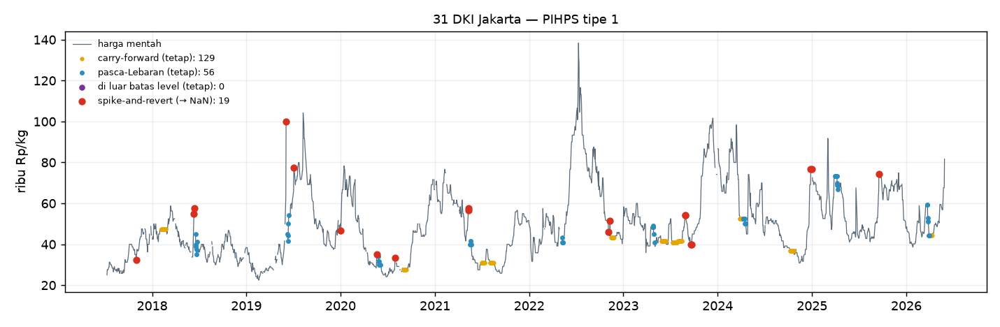
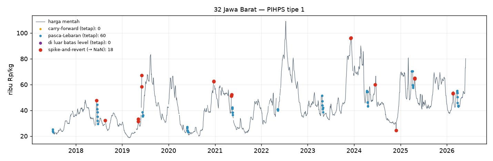
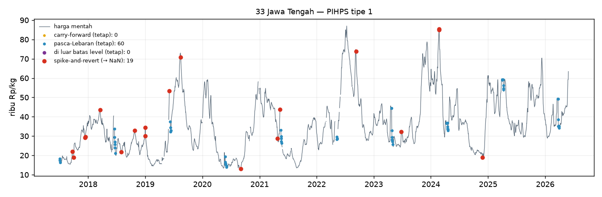
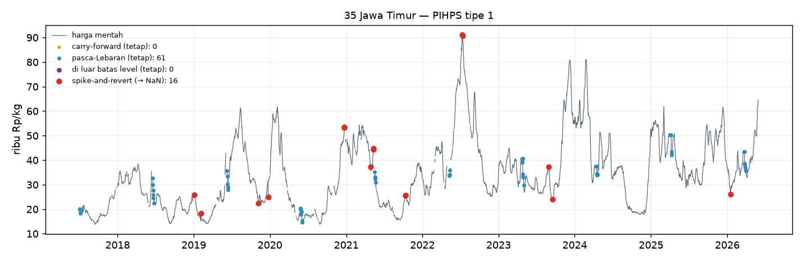
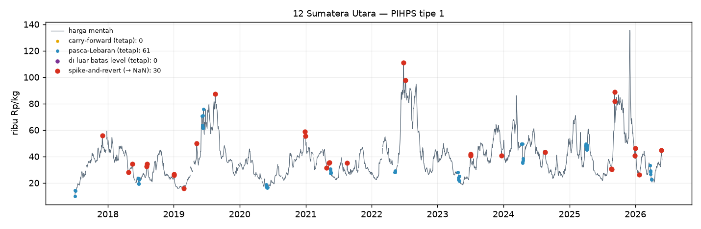

# QA cleaning harga (MDE-H2-01)

- Input: `data/interim/pihps_long.parquet` → output `data/interim/prices_clean.parquet` (139,004 baris, skema kontrak `prices_clean`, 12 kolom)
- Kode: `src/renaro/data/cleaning.py`; parameter: `configs/data/v1.yaml`; dibuat ulang dengan `python -m renaro.data.cleaning`
- Rentang: 2017-07-03 .. 2026-05-29 (< holdout 2026-06-01); price_type [1, 4]
- Tanggal Idulfitri: fallback di kode (calendar.csv MDE-H2-02 belum ada): 2017-06-25, 2018-06-15, 2019-06-05, 2020-05-24, 2021-05-13, 2022-05-02, 2023-04-22, 2024-04-10, 2025-03-31, 2026-03-21

## Ringkasan

| Item | Nilai |
|---|---|
| Baris masuk / dibuang sebagai baris rusak (Dum) | 139,265 / 261 |
| Nama provinsi tak ter-map | 0 (nama baru akan menghentikan proses) |
| Duplikat kunci (date, prov_code, price_type) / yang nilainya berbeda | 0 / 0 |
| Harga ≤ 0 → NaN | 0 |
| Titik berharga sebelum cleaning | 133,687 |
| **Titik yang di-NaN-kan cleaning (spike-and-revert)** | **790 (0.591%) — di bawah ambang 1%** |
| Spike di jendela pasca-Lebaran (dipertahankan) | 49 |
| flag_outlier total (level + spike) | 923 |
| flag_post_lebaran | 4,435 |
| flag_carry_forward — tipe 1 / tipe 4 | 1,837 (2.3%) / 57,001 (95.1%) |

Aturan: median bergulir 21 hari kerja (terpusat) pada log harga per (provinsi, tipe); deviasi bila |log p − median| > 5·MAD (MAD mentah, batas bawah 0.02); spike-and-revert = run deviasi searah ≤ 2 hari kerja yang diapit titik normal. Hanya spike-and-revert di luar jendela Idulfitri..+10 hari yang di-NaN-kan. Batas level [5,000, 250,000] Rp/kg hanya diberi flag (perlu konfirmasi RL). `available_at` = hari kerja PIHPS berikutnya (tanggal dengan laporan ≥ 50% provinsi).

Catatan carry-forward: tipe 4 (produsen) hampir selalu berupa nilai yang sama berminggu-minggu, sehingga sebagian besar barisnya ditandai; ini sifat sumber, bukan galat. Untuk tipe 1, provinsi dengan proporsi tertinggi: 82 Maluku Utara (60.3%), 31 DKI Jakarta (5.5%), 72 Sulawesi Tengah (5.2%). Perlakuan diputuskan RL di protokol; tidak ada titik yang dihapus karena flag ini.

**Kasus audit brief §7.1 (Rp19.000 nasional, 1 Feb 2022): dilewati atas keputusan tim (2026-11-25).** Data 2022 tetap dipakai utuh. Catatan: pada 2022-02-01 semua provinsi bernilai "-" (Imlek) dan baris nasional juga "-" di unduhan 2026-11-24, jadi nilai Rp19.000 tidak muncul di level provinsi. Aturan spike-and-revert diuji dengan kasus sintetis yang sama di `tests/test_prices_clean.py`.

## Validasi silang SP2KP (2024-02-01 .. 2026-05-31, tipe 1)

SP2KP hanya pembanding; target tidak diubah. Provinsi dengan median |selisih| > 15%: **5** (82 Maluku Utara, 16 Sumatera Selatan, 81 Maluku, 91 Papua Barat, 94 Papua). Median korelasi log-harga: 0.935. Tabel lengkap juga di `reports/qa/sp2kp_crosscheck.csv`.

| Kode | Provinsi | Hari | Korelasi log | Median \|selisih\| | Median PIHPS/SP2KP | SP2KP agregat |
|---|---|---:|---:|---:|---:|:---:|
| 82 | Maluku Utara | 549 | 0.530 | 29.6% ⚠ | 1.296 |  |
| 16 | Sumatera Selatan | 539 | 0.919 | 24.8% ⚠ | 1.247 |  |
| 81 | Maluku | 542 | 0.840 | 23.6% ⚠ | 1.236 |  |
| 91 | Papua Barat | 550 | 0.686 | 18.4% ⚠ | 0.826 | ya |
| 94 | Papua | 553 | 0.710 | 17.7% ⚠ | 0.826 | ya |
| 62 | Kalimantan Tengah | 549 | 0.885 | 15.0% | 1.148 |  |
| 34 | DI Yogyakarta | 546 | 0.963 | 14.0% | 1.139 |  |
| 14 | Riau | 548 | 0.974 | 14.0% | 1.139 |  |
| 71 | Sulawesi Utara | 551 | 0.917 | 13.6% | 0.869 |  |
| 32 | Jawa Barat | 548 | 0.985 | 13.1% | 1.131 |  |
| 21 | Kepulauan Riau | 544 | 0.927 | 12.3% | 0.877 |  |
| 72 | Sulawesi Tengah | 542 | 0.913 | 11.2% | 0.890 |  |
| 75 | Gorontalo | 546 | 0.919 | 10.3% | 1.086 |  |
| 51 | Bali | 546 | 0.943 | 9.0% | 1.011 |  |
| 35 | Jawa Timur | 555 | 0.983 | 8.2% | 1.080 |  |
| 74 | Sulawesi Tenggara | 543 | 0.890 | 7.9% | 0.980 |  |
| 76 | Sulawesi Barat | 546 | 0.919 | 7.9% | 0.932 |  |
| 65 | Kalimantan Utara | 547 | 0.835 | 7.7% | 1.069 |  |
| 13 | Sumatera Barat | 541 | 0.963 | 7.5% | 1.072 |  |
| 15 | Jambi | 539 | 0.962 | 7.4% | 0.983 |  |
| 33 | Jawa Tengah | 555 | 0.980 | 7.4% | 1.072 |  |
| 53 | Nusa Tenggara Timur | 551 | 0.912 | 7.2% | 1.068 |  |
| 36 | Banten | 546 | 0.951 | 7.1% | 1.060 |  |
| 19 | Kepulauan Bangka Belitung | 549 | 0.959 | 7.1% | 1.066 |  |
| 61 | Kalimantan Barat | 535 | 0.897 | 6.8% | 0.990 |  |
| 52 | Nusa Tenggara Barat | 550 | 0.955 | 6.2% | 0.970 |  |
| 31 | DKI Jakarta | 548 | 0.915 | 6.2% | 0.988 |  |
| 64 | Kalimantan Timur | 548 | 0.926 | 6.1% | 0.950 |  |
| 63 | Kalimantan Selatan | 551 | 0.943 | 5.9% | 0.980 |  |
| 11 | Aceh | 537 | 0.984 | 5.4% | 1.051 |  |
| 18 | Lampung | 552 | 0.968 | 4.7% | 1.027 |  |
| 12 | Sumatera Utara | 545 | 0.983 | 4.5% | 1.041 |  |
| 17 | Bengkulu | 548 | 0.968 | 3.9% | 1.014 |  |
| 73 | Sulawesi Selatan | 547 | 0.979 | 3.0% | 0.998 |  |

## Plot contoh (tipe 1)

## Flag per provinsi — tipe 1 (pasar tradisional, target)

| Kode | Provinsi | Baris | Berharga | Level | Spike→NaN | Spike Lebaran (tetap) | Pasca-Lebaran | Carry-fwd |
|---|---|---:|---:|---:|---:|---:|---:|---:|
| 11 | Aceh | 2325 | 2242 | 0 | 37 | 2 | 73 | 0 |
| 12 | Sumatera Utara | 2325 | 2249 | 0 | 30 | 3 | 73 | 0 |
| 13 | Sumatera Barat | 2325 | 2229 | 0 | 13 | 4 | 73 | 0 |
| 14 | Riau | 2325 | 2237 | 0 | 14 | 1 | 73 | 0 |
| 15 | Jambi | 2325 | 2228 | 0 | 40 | 0 | 73 | 0 |
| 16 | Sumatera Selatan | 2325 | 2229 | 0 | 28 | 2 | 73 | 0 |
| 17 | Bengkulu | 2325 | 2234 | 0 | 12 | 1 | 73 | 0 |
| 18 | Lampung | 2325 | 2240 | 0 | 27 | 0 | 73 | 0 |
| 19 | Kepulauan Bangka Belitung | 2325 | 2235 | 0 | 14 | 2 | 73 | 11 |
| 21 | Kepulauan Riau | 2325 | 2225 | 0 | 11 | 0 | 73 | 0 |
| 31 | DKI Jakarta | 2325 | 2225 | 0 | 19 | 1 | 73 | 129 |
| 32 | Jawa Barat | 2325 | 2244 | 0 | 18 | 0 | 73 | 0 |
| 33 | Jawa Tengah | 2325 | 2272 | 0 | 19 | 1 | 73 | 0 |
| 34 | DI Yogyakarta | 2325 | 2178 | 0 | 20 | 5 | 73 | 46 |
| 35 | Jawa Timur | 2325 | 2248 | 0 | 16 | 0 | 73 | 0 |
| 36 | Banten | 2325 | 2239 | 0 | 19 | 5 | 73 | 0 |
| 51 | Bali | 2325 | 2231 | 0 | 23 | 1 | 73 | 35 |
| 52 | Nusa Tenggara Barat | 2325 | 2239 | 0 | 19 | 2 | 73 | 0 |
| 53 | Nusa Tenggara Timur | 2325 | 2178 | 0 | 15 | 0 | 73 | 33 |
| 61 | Kalimantan Barat | 2325 | 2228 | 0 | 35 | 1 | 73 | 0 |
| 62 | Kalimantan Tengah | 2325 | 2212 | 0 | 14 | 1 | 73 | 34 |
| 63 | Kalimantan Selatan | 2325 | 2245 | 0 | 18 | 0 | 73 | 0 |
| 64 | Kalimantan Timur | 2325 | 2225 | 0 | 23 | 1 | 73 | 0 |
| 65 | Kalimantan Utara | 2325 | 2228 | 0 | 11 | 3 | 73 | 12 |
| 71 | Sulawesi Utara | 2325 | 2231 | 0 | 39 | 1 | 73 | 13 |
| 72 | Sulawesi Tengah | 2325 | 2234 | 0 | 20 | 2 | 73 | 122 |
| 73 | Sulawesi Selatan | 2325 | 2232 | 0 | 13 | 0 | 73 | 0 |
| 74 | Sulawesi Tenggara | 2325 | 2239 | 0 | 29 | 2 | 73 | 0 |
| 75 | Gorontalo | 2325 | 2245 | 0 | 26 | 0 | 73 | 0 |
| 76 | Sulawesi Barat | 2325 | 2236 | 0 | 25 | 0 | 73 | 0 |
| 81 | Maluku | 2325 | 2212 | 0 | 32 | 1 | 73 | 0 |
| 82 | Maluku Utara | 2325 | 2181 | 0 | 27 | 3 | 73 | 1402 |
| 91 | Papua Barat | 2325 | 2257 | 0 | 35 | 0 | 73 | 0 |
| 94 | Papua | 2325 | 2267 | 0 | 38 | 4 | 73 | 0 |
| | **Total** | 79050 | 75874 | 0 | 779 | 49 | 2482 | 1837 |

## Flag per provinsi — tipe 4 (produsen)

| Kode | Provinsi | Baris | Berharga | Level | Spike→NaN | Spike Lebaran (tetap) | Pasca-Lebaran | Carry-fwd |
|---|---|---:|---:|---:|---:|---:|---:|---:|
| 11 | Aceh | 1934 | 1933 | 0 | 1 | 0 | 63 | 1887 |
| 12 | Sumatera Utara | 1934 | 1932 | 0 | 1 | 0 | 63 | 1870 |
| 13 | Sumatera Barat | 1934 | 1933 | 0 | 0 | 0 | 63 | 1924 |
| 14 | Riau | 1934 | 1891 | 0 | 0 | 0 | 63 | 1881 |
| 15 | Jambi | 1934 | 1882 | 0 | 0 | 0 | 63 | 1877 |
| 16 | Sumatera Selatan | 1934 | 1816 | 0 | 0 | 0 | 63 | 1809 |
| 17 | Bengkulu | 1934 | 1785 | 0 | 2 | 0 | 63 | 1557 |
| 18 | Lampung | 1934 | 1926 | 0 | 0 | 0 | 63 | 1919 |
| 19 | Kepulauan Bangka Belitung | 1934 | 1886 | 0 | 0 | 0 | 63 | 1873 |
| 21 | Kepulauan Riau | 1934 | 1827 | 0 | 1 | 0 | 63 | 1815 |
| 32 | Jawa Barat | 1934 | 1932 | 0 | 1 | 0 | 63 | 1780 |
| 33 | Jawa Tengah | 1934 | 1933 | 0 | 1 | 0 | 63 | 1877 |
| 34 | DI Yogyakarta | 1934 | 1929 | 0 | 0 | 0 | 63 | 1924 |
| 35 | Jawa Timur | 1934 | 1933 | 1 | 1 | 0 | 63 | 1853 |
| 36 | Banten | 1934 | 1800 | 0 | 0 | 0 | 63 | 1795 |
| 52 | Nusa Tenggara Barat | 1934 | 1929 | 22 | 0 | 0 | 63 | 1923 |
| 53 | Nusa Tenggara Timur | 1304 | 1089 | 0 | 0 | 0 | 39 | 1089 |
| 61 | Kalimantan Barat | 1934 | 1862 | 23 | 0 | 0 | 63 | 1856 |
| 62 | Kalimantan Tengah | 1934 | 1541 | 0 | 0 | 0 | 63 | 1541 |
| 63 | Kalimantan Selatan | 1934 | 1911 | 23 | 0 | 0 | 63 | 1906 |
| 64 | Kalimantan Timur | 1934 | 1908 | 0 | 0 | 0 | 63 | 1902 |
| 65 | Kalimantan Utara | 1934 | 1918 | 0 | 0 | 0 | 63 | 1913 |
| 71 | Sulawesi Utara | 1934 | 1930 | 0 | 0 | 0 | 63 | 1921 |
| 72 | Sulawesi Tengah | 1934 | 1927 | 23 | 0 | 0 | 63 | 1906 |
| 73 | Sulawesi Selatan | 1934 | 1933 | 0 | 0 | 0 | 63 | 1933 |
| 74 | Sulawesi Tenggara | 1934 | 1932 | 0 | 0 | 0 | 63 | 1924 |
| 75 | Gorontalo | 1934 | 1715 | 41 | 0 | 0 | 63 | 1709 |
| 76 | Sulawesi Barat | 1934 | 1822 | 0 | 0 | 0 | 63 | 1814 |
| 81 | Maluku | 1934 | 1862 | 0 | 0 | 0 | 63 | 1857 |
| 82 | Maluku Utara | 630 | 332 | 0 | 0 | 0 | 24 | 327 |
| 91 | Papua Barat | 1934 | 1931 | 0 | 3 | 0 | 63 | 1911 |
| 94 | Papua | 1934 | 1933 | 0 | 0 | 0 | 63 | 1928 |
| | **Total** | 59954 | 57813 | 133 | 11 | 0 | 1953 | 57001 |
