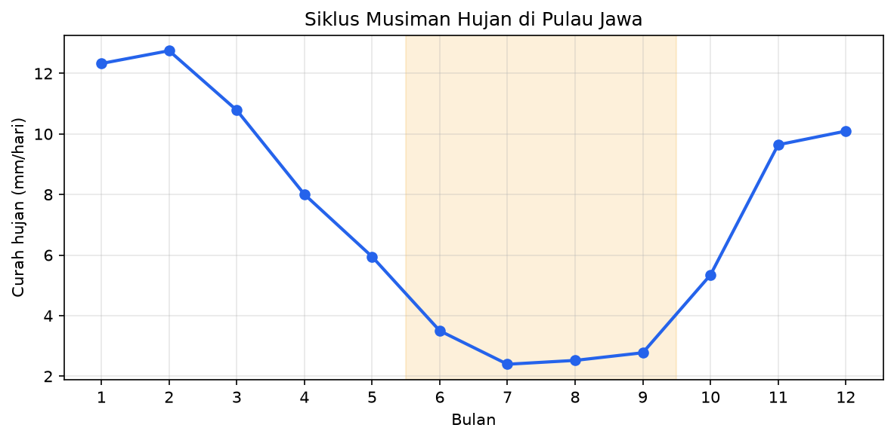

# CGS-H2-01 - production-weighted daily rainfall

- Rows: **116,892**; provinces: **34**; days: **3438**.
- Missing `rain_mm`: **0** (0 expected).
- Variants: final_sat.
- Grid: 360 x 950; 0.05 deg; CHIRPS v3 final/sat.
- `rain_mm` = production-weighted where lagged kab production exists; `rain_mm_area` = area-weighted.

## Weight method per year

| year | method |
|---:|---|
| 2017 | area |
| 2018 | area |
| 2019 | area |
| 2020 | area |
| 2021 | area |
| 2022 | area |
| 2023 | area |
| 2024 | area |
| 2025 | production_2024 |
| 2026 | production_2024 |

## Annual rainfall per province (mm)

| year | min | median | max |
|---:|---:|---:|---:|
| 2017 | 1827 | 3199 | 4234 |
| 2018 | 1545 | 2632 | 3667 |
| 2019 | 1246 | 2257 | 3304 |
| 2020 | 1745 | 2980 | 3954 |
| 2021 | 2294 | 3158 | 4044 |
| 2022 | 2001 | 3341 | 4146 |
| 2023 | 1496 | 2483 | 3767 |
| 2024 | 1790 | 2870 | 4013 |
| 2025 | 2127 | 3320 | 4836 |

2026 is partial (Jan-May) and is excluded from the annual table.

## Annual outliers vs the 1,500-4,000 mm sanity band

- Province-years outside the band (complete years): **19**.
- The band is a sanity guard, not a hard rejection. 2019 is a dry year in the east (e.g. Gorontalo 1,245 mm); 2025 is wet in Banten/Papua (up to 4,836 mm). These are plausible CHIRPS values, not processing errors.

| prov_code | year | mm |
|---|---:|---:|
| 75 | 2019 | 1246 |
| 53 | 2019 | 1318 |
| 52 | 2019 | 1477 |
| 52 | 2023 | 1496 |
| 81 | 2022 | 4010 |
| 61 | 2024 | 4013 |
| 91 | 2017 | 4013 |
| 36 | 2022 | 4015 |

## Java seasonal sanity (mean mm/day)

| prov_code | Jun-Sep | Oct-May |
|---|---:|---:|
| 31 | 3.32 | 7.60 |
| 32 | 4.46 | 10.95 |
| 33 | 3.06 | 10.63 |
| 34 | 1.45 | 8.50 |
| 35 | 1.68 | 9.14 |

## Notes

- Kab-level production history is not published; only 2024 kab production is validated. Therefore 2017-2024 use area weights and 2025-2026 use 2024 production shares (the latest observed). This is recorded in `weight_method`.
- The weight matrix reproduces the H1 package exactly: 61,825 cells, 42 nearest-9 kabs, 0 count mismatches.
- Daily CHIRPS is disaggregated from pentads; extremes/dry spells are defined on pentad accumulations in CGS-H2-02.

## Figure

Rata-rata curah hujan harian per bulan untuk 5 provinsi Jawa (kode 31-35),
2017-01-01..2026-05-31. Area kuning = musim kering Jun-Sep. Dibuat ulang dengan
`python scripts/cgs/plot_rain_seasonal.py` dari `data/interim/rain_prov_daily.parquet`.
