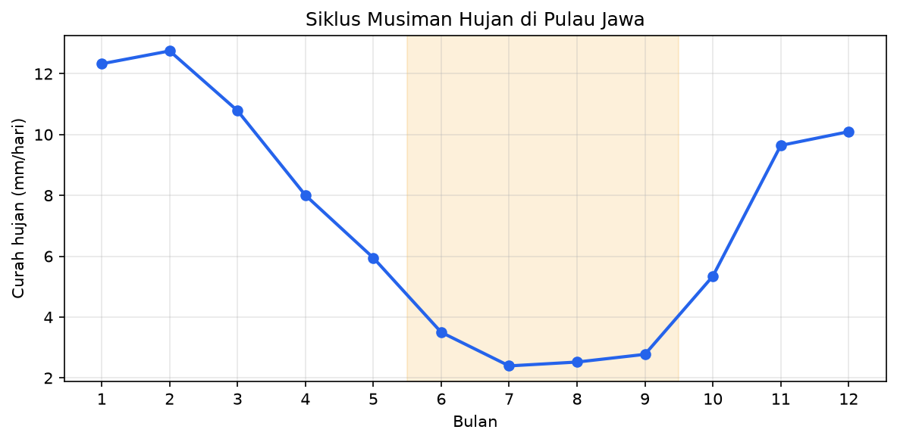

# 5. Iklim dan Regime

> **Status Dokumen**: Draf Sprint 1 (`ALL-H6-01`) · **Peran**: CGS (*Climate & Geospatial Scientist*, `@fariq`) · **Tanggal**: Sabtu, 28 November 2026 (`H6`)
> **Rujukan**: `docs/cgs_h1_data.md`, `docs/cgs_h2_data.md`, `docs/regime_definitions.md`, `docs/data_contract.md`, `configs/global.yaml`, `reports/qa/CGS-H1_summary.md`, `reports/qa/CGS-H2_summary.md`, `reports/qa/eval_splits_summary.md`, dan `reports/qa/dataset_v1.md`.

---

## 5.1 Ringkasan peran CGS

CGS memasok lapisan iklim dan geospasial yang dipakai bersama oleh MDE, MLE, dan RL: curah hujan CHIRPS v3 yang diproyeksikan ke 34 provinsi, indeks ENSO RONI, bobot produksi/luas kabupaten-kota, tabel ketersediaan (`available_at`), serta label regime iklim untuk evaluasi. CGS **tidak** memilih model harga dan **tidak** memasukkan label regime ke dalam fitur atau panel; label regime bersifat *evaluation-only*.

Prinsip yang dijaga di seluruh paket:

1. **Tanpa kebocoran waktu**: fitur hanya boleh dipakai pada tanggal keputusan $t$ bila `available_at <= t`.
2. **Tanpa angka fabrikasi**: data produksi 2025/2026 yang belum terbit tidak diinterpolasi atau dikarang; bobot terakhir yang tersedia dipakai dan keterbatasannya dicatat.
3. **Holdout tetap tersegel**: seluruh artefak bersama berhenti sebelum `2026-06-01`; tidak ada nilai holdout di laporan ini.
4. **Reproduksibel**: setiap paket data memiliki verifier dan checksum; hasil verifikasi terakhir: `verify_h1.py` **589/589 checks PASS** dan `verify_cgs_h2.py` **39/39 checks PASS** (28 November 2026).

---

## 5.2 Sumber data

| Komponen | Sumber resmi | Cakupan *shared* | Resolusi / satuan | Lokasi | Status |
|---|---|---|---|---|---|
| Curah hujan harian | CHIRPS v3.0 daily `final/sat` (Climate Hazards Center, UC Santa Barbara) | 2017-01-01 .. 2026-05-31; **113 bulan / 3.438 hari** | 0,05°; grid 360 × 950; mm/hari | `data/raw/chirps_v3/` | **DONE**; 0 bulan hilang; 98.174 sel valid/hari |
| Indeks ENSO | NOAA CPC RONI (ERSSTv6, basis 1991–2020) | DJF 1950 .. FMA 2026; **915 musim** | anomali suhu °C; fase 5-musim ±0,5 | `data/raw/enso/roni.csv`, `data/interim/roni.parquet` | **DONE**; 6 musim setelah FMA 2026 tersegel |
| Produksi cabai 2024 tingkat kab/kota | Satudata Pertanian, Ditjen Hortikultura, dataset 392 (`Cabai Besar-Kab 2024`) | **514 kab/kota**, 34 provinsi; 1.469.325,119 ton | ton/tahun | `data/raw/bps/produksi_kab.csv` | **DONE** |
| Seri produksi provinsi | BPS WebAPI var 61 / turvar 132 (2017–2023) + Satudata 2024 | 2017–2024; **269 baris** | ton/tahun | `data/raw/bps/produksi_prov.csv` | **DONE untuk data tersedia**; 2018/2021/2023 tidak memuat baris DKI Jakarta |
| Batas wilayah | geoBoundaries gbOpen IDN ADM2 2020 | **514 kab/kota**; 34 provinsi struktur lama | EPSG:4326; poligon ADM2 | `data/raw/boundaries/idn_adm2.gpkg` | **DONE**; join produksi 514/514 (513 exact + 1 fuzzy) |
| Kalender | SKB 3 Menteri (Ramadan, Lebaran, Idul Adha, libur, cuti bersama) | 2017–2026 | harian | `data/ref/` | **DONE**; `known_in_advance` |
| Harga PIHPS | Bank Indonesia (dikelola MDE) | 2017-07-03 .. 2026-05-29 | Rp/kg; hari kerja | `data/interim/prices_clean.parquet` | **DONE** (input dari MDE; bukan produksi CGS) |

Catatan sumber:

- **CHIRPS**: berkas bulanan NPZ berasal dari COG CHC; `manifest.csv` mencatat URL, varian, ukuran, dan status per hari. Nilai harian CHIRPS merupakan disagregasi dari pentad, sehingga presisi harian tidak diklaim independen (lihat §5.8).
- **RONI**: tidak tersedia arsip vintage historis lengkap; `available_at` memakai aturan konservatif `center_month + 3 bulan`. Dua sampai tiga musim terakhir bersifat *provisional* dan dapat direvisi.
- **Produksi 2025/2026**: belum dipublikasikan per 28 November 2026 (Satudata dataset 475 masih memuat angka 2024; BPS WebAPI berhenti di 2023). Sesuai aturan proyek `y-1`, produksi 2024 dipakai sebagai bobot terakhir untuk 2025–2026. Tidak ada angka 2025/2026 yang dikarang.
- **Batas wilayah**: 5 fitur non-admin dari 519 fitur geoBoundaries dikeluarkan; 514 kab/kota yang tersisa dipetakan ke 34 provinsi struktur lama.

---

## 5.3 Pembobotan curah hujan ke tingkat provinsi

CHIRPS menyediakan grid piksel, sedangkan unit analisis adalah provinsi. Curah hujan provinsi dihitung sebagai rata-rata tertimbang piksel di dalam wilayah provinsi:

$$
R_{p,t} = \sum_{k \in \mathcal{K}(p)} w_{k,p,t}\, r_{k,t},
\qquad \sum_{k \in \mathcal{K}(p)} w_{k,p,t} = 1,
$$

dengan $r_{k,t}$ curah hujan piksel $k$ pada hari $t$, dan $w_{k,p,t}$ bobot piksel $k$ untuk provinsi $p$. Piksel laut/tanpa data (`NaN`) tidak diisi nol; bobot dinormalisasi ulang di antara piksel valid.

**Matriks bobot.** `data/interim/w_kab_pixel.npz` berukuran 514 kab/kota × 342.000 piksel dengan **61.825 sel nonzero**. Sebanyak **42 kota kecil** memakai *fallback* 9 piksel terdekat karena poligonnya terlalu kecil untuk grid 0,05°. Jumlah sel dan metode *fallback* identik dengan paket H1 (0 *count mismatch*).

**Aturan bobot per tahun** (`weight_method`):

| Periode | Bobot | Alasan |
|---|---|---|
| 2017–2024 | Bobot luas wilayah kab/kota | Riwayat produksi kab/kota tidak tersedia untuk semua tahun |
| 2025–2026 | Pangsa produksi cabai 2024 per kab/kota | Produksi 2024 adalah observasi terakhir yang tersedia (aturan `y-1`) |

**Keluaran.** `data/interim/rain_prov_daily.parquet` berisi **116.892 baris** (34 provinsi × 3.438 hari), **0 `rain_mm` hilang**, dengan kolom `variant`, `rain_mm` (bobot produksi/luas), `rain_mm_area` (pembanding bobot luas), dan `weight_method`.

**Pemeriksaan kewajaran.** Total hujan tahunan provinsi berada pada 1.246–4.836 mm. Sebanyak **19 provinsi-tahun** berada di luar pita sanity 1.500–4.000 mm; pita ini adalah *guard*, bukan penolakan keras. Contoh yang terdokumentasi: Gorontalo 2019 (1.246 mm, tahun kering di timur) dan Banten/Papua 2025 (hingga 4.836 mm, tahun basah). Pola musiman Jawa juga wajar: rata-rata Jun–Sep 1,45–4,46 mm/hari versus Okt–Mei 7,60–10,95 mm/hari.



*Gambar 5.1 — Rata-rata curah hujan harian per bulan untuk lima provinsi Jawa (kode 31–35), 2017-01-01 .. 2026-05-31. Area kuning = musim kering Jun–Sep. Sumber: `reports/qa/fig_rain_seasonal.png`; dibuat ulang dengan `python scripts/cgs/plot_rain_seasonal.py`.*

---

## 5.4 Indeks pentad dan fitur iklim

Karena CHIRPS harian adalah disagregasi pentad, indeks ekstrem dan kekeringan didefinisikan pada **pentad** (5 hari): hari 1–5, 6–10, 11–15, 16–20, 21–25, dan 26–akhir bulan; 72 pentad per tahun. Output `data/interim/climate_features.parquet` berisi **23.052 baris** (34 provinsi × 678 pentad), mencakup 2017-01-05 .. 2026-05-31.

| Indeks | Definisi | Kegunaan |
|---|---|---|
| `rain_pentad_mm` | Jumlah curah hujan 5 hari | Intensitas hujan pentad |
| `rain_mm` | Rata-rata harian di dalam pentad | Pembanding skala harian |
| `rain_pentad_anom` | Z-score `rain_pentad_mm` terhadap rata-rata/standar deviasi pentad-of-year dengan jendela ±2 pentad | Anomali hujan jangka pendek |
| `rain_30d_mm` | Akumulasi 6 pentad (30 hari) | Akumulasi bulanan |
| `rain_30d_anom` | Z-score `rain_30d_mm` dengan jendela baseline yang sama | Anomali 30 hari |
| `dry_spell_days` | 5 × jumlah pentad berturut-turut dengan `rain_pentad_mm < 5 mm` | Durasi kering |
| `extreme_5d` | 1 bila `rain_pentad_mm` melebihi p95 baseline provinsi | Hujan ekstrem |
| `rain_mm_prelim`, `rain_pentad_mm_prelim` | Versi CHIRPS `prelim/sat` untuk uji sensitivitas | Opsi A (rilis preliminary + 5 hari) |

**Baseline.** Klimatologi memakai **2017 saja** (pra-2018), sesuai *pre-2018 rule* pada kontrak. `p20_global` adalah persentil ke-20 pentad baseline per provinsi; `p95` dipakai untuk `extreme_5d`. Karena baseline hanya satu tahun, ambang ekstrem dijaga pada tingkat *exceedance* mendekati 5%: laju `extreme_5d` pada baseline adalah **5,56%**, dan laju `dry_spell_days > 0` adalah **7,15%**.

**Kualitas data.**

- `rain_pentad_anom`: **0 nilai hilang**.
- `rain_30d_anom`: **1.088 nilai hilang** yang seluruhnya berada di tepi baseline — 170 baris di pentad 1–5 tahun 2017 (tidak ada *lead-in* 2016 untuk akumulasi 30 hari) dan 102 baris per tahun pada pentad 2–4 tahun 2018–2026 (jendela baseline 2017 tidak memiliki cukup nilai 30 hari yang finite). `rain_30d_mm` sendiri lengkap untuk semua pentad 2018+; ini keterbatasan baseline, bukan kegagalan jendela 30 hari.
- `extreme_5d` tidak pernah hilang; `dry_spell_days` juga lengkap.

**Fitur yang masuk model.** `docs/feature_dict.csv` mendaftarkan **24 fitur** dalam **7 keluarga ketersediaan** (`price`, `rain_daily_final`, `rain_pentad_final`, `rain_prelim`, `roni`, `production_weight`, `calendar`). Lima fitur iklim yang dipakai Modul 1 adalah `rain_pentad_anom`, `rain_30d_anom`, `dry_spell_days`, `extreme_5d`, dan `roni`; fitur hujan mentah dan versi prelim dipakai untuk analisis sensitivitas, bukan untuk menambah kebocoran.

---

## 5.5 Ketersediaan (`available_at`) dan aturan anti-kebocoran

Aturan emas: untuk setiap baris fitur dengan tanggal observasi $d$, tanggal publikasi `available_at` harus memenuhi `available_at <= t` pada tanggal keputusan $t$. Penggabungan dilakukan dengan `pandas.merge_asof(direction="backward")`, bukan join biasa. Tabel `reports/qa/availability.csv` memuat **7 keluarga fitur**:

| Keluarga | Sumber / varian | Aturan | Lag | Bukti keputusan |
|---|---|---|---|---|
| `rain_daily_final` | CHIRPS v3 `final/sat` | `pentad_end_plus_lag` | **2 hari** | `docs/decisions/ALL-H1-01.md#keputusan-3`; `reports/qa/chirps_release_lag.md` |
| `rain_pentad_final` | CHIRPS v3 `final/sat` | `pentad_end_plus_lag` | **2 hari** | idem |
| `rain_prelim` | CHIRPS v3 `prelim/sat` | `release_timestamp` | **5 hari** (sensitivitas Opsi A) | `reports/qa/chirps_release_lag_probe.csv` |
| `roni` | CPC NOAA RONI (ERSSTv6) | `vintage_or_conservative_3m` | `center_month + 3 bulan` | `data/raw/enso/roni_vintage_log.csv`; `reports/qa/roni.md` |
| `production_weight` | Satudata Pertanian / BPS | `year_plus_1` | produksi tahun $y-1$ | `data/raw/bps/README.md` |
| `calendar` | SKB 3 Menteri | `known_in_advance` | 0 | `docs/data_contract.md` §2.2 |
| `price` | PIHPS / SP2KP | `next_workday` | 1 hari kerja | `docs/data_contract.md` §2.1 |

**Validasi.** `climate_features.available_at` tidak pernah null dan selalu `>= date`; nilai maksimumnya **2026-06-02** (pentad terakhir + 2 hari). `tests/test_no_leakage.py` lulus **15/15** pada 28 November 2026, termasuk empat uji *truncation* (input dipotong pada tanggal acak dan tanggal tetap 2022-05-10; semua kolom baris sebelum $T$ identik) serta pemeriksaan bahwa tidak ada kolom label regime di panel.

**Catatan implementasi.** Helper `assert_available()` di `src/renaro/contract.py` memeriksa `available_at <= date`. Arah ini benar bila `date` adalah tanggal keputusan, tetapi terbalik bila dipakai pada baris sumber (tanggal observasi): kontrak sumber menuntut `available_at >= date` agar sebuah observasi tidak dipakai sebelum dirilis. Builder dan verifier (`verify_cgs_h2.py`) memakai aturan sumber yang benar; helper tersebut tidak dipakai di pipeline produksi dan perlu diperjelas agar tidak menyesatkan. Catatan ini juga tercantum di `docs/cgs_h2_data.md` §4.

---

## 5.6 Definisi regime iklim (EVAL ONLY)

Label regime dipakai untuk **stratifikasi evaluasi**, bukan fitur model. Definisi lengkap ada di `docs/regime_definitions.md`; implementasinya di `src/renaro/climate/regimes.py` (CGS-H2-04) dan pembentukan split di `src/renaro/eval/regimes.py` (CGS-H4-01).

| Regime | Definisi operasional | Prioritas |
|---|---|---:|
| `dry` | `rain_pentad_mm < p20_global` selama **≥ 3 pentad berturut-turut**; label berlaku untuk setiap hari dalam pentad | 1 (tertinggi) |
| `extreme_wet` | `extreme_5d == 1`, yaitu akumulasi pentad di atas p95 baseline provinsi | 2 |
| `el_nino` | Fase RONI `el_nino` dari tabel episode resmi, memakai musim terbaru dengan `available_at <= tanggal` (*as-of join*) | 3 |
| `la_nina` | Fase RONI `la_nina`, aturan *as-of* yang sama | 4 |
| `normal` | Bukan `dry`, bukan `extreme_wet`, dan ENSO netral | 5 (terendah) |

**Mengapa *as-of join* penting.** Label ENSO tidak boleh memakai musim yang baru dipublikasikan setelah tanggal keputusan. Untuk setiap tanggal, sistem memilih musim RONI terakhir yang `available_at`-nya sudah lewat; `episode_id` disalin dari tabel episode (`none` untuk netral). Ini mencegah kebocoran "masa depan" ke label evaluasi.

**Sebaran label *shared*.** Total **116.892 baris harian** (34 provinsi × 3.438 hari), 2017-01-01 .. 2026-05-31:

| Regime | Node-hari | Pangsa |
|---|---:|---:|
| `la_nina` | 58.311 | 49,9% |
| `normal` | 28.955 | 24,8% |
| `el_nino` | 12.722 | 10,9% |
| `dry` | 9.804 | 8,4% |
| `extreme_wet` | 7.100 | 6,1% |

**Split evaluasi per regime (CGS-H4-01).** Split memakai panel `dataset_v1` dan label di atas; ringkasan lengkap ada di `reports/qa/eval_splits_summary.md`. Ambang "CI lebar" adalah **< 200 target observed** per regime per part.

| Origin | Part | Regime dengan ≥ 200 observasi | Catatan |
|---|---|---|---:|
| O1 (uji 2023) | test | 5/5 | `dry` 1.414; `extreme_wet` 275; `el_nino` 1.605; `la_nina` 4.071; `normal` 1.407 |
| O2 (uji 2024) | test | 5/5 | `dry` 768; `extreme_wet` 553; `el_nino` 3.239; `la_nina` 1.338; `normal` 3.010 |
| O3 (uji 2025–Mei 2026) | test | 4/5 | `el_nino` tidak ada pada periode uji; regime lain ≥ 200 |
| HOLDOUT | test | **tersegel** | Tidak ada label/nilai holdout di laporan ini |

Label regime **tidak boleh** di-join ke `panel.parquet`, tidak boleh menjadi fitur, dan tidak boleh dipakai untuk memilih model. `tests/test_no_leakage.py` memverifikasi tidak ada kolom regime di panel; jumlah label sama dengan jumlah baris panel ketika di-expand ke hari kalender.

---

## 5.7 Status holdout dan kesiapan CGS-H6-01

Holdout Sprint 1 didefinisikan sebagai tanggal **≥ 2026-06-01** dan disimpan di luar repo (`RENARO_SEALED_DIR`, `D:\renaro_sealed`). Metadata segel (bukan nilai):

- PIHPS holdout: **8.442 baris**, 2026-06-01 .. 2026-11-23.
- RONI holdout: **6 musim** (2026-MAM .. 2026-ASO).
- CHIRPS final: **153 hari** (2026-06-01 .. 2026-10-31); preliminary: **20 hari** (2026-11-01 .. 2026-11-20).
- Panel holdout v1: **79.832 baris** total (2017-07-03 .. 2026-10-30), dengan **3.604 baris** pada periode holdout (2026-06-02 .. 2026-10-30; 2026-06-01 libur).
- Integritas: `SHA256SUMS.txt` **196/196 OK** dan `panel_v1/SHA256SUMS` **6/6 OK** (diverifikasi ulang 28 November 2026). `content_hash` prefix panel identik dengan `dataset_v1` (`fceeecbf5e9f...`, 0 mismatch).
- Status: **TERSEGEL**. Tidak ada `HOLDOUT_UNSEALED`; tidak ada nilai holdout yang dibaca untuk laporan ini.

**Kesiapan pembukaan.** Tag `gate2-freeze` sudah ada di remote dan menunjuk commit `b0d0ff9`; `frozen/manifest.yaml` memuat **10 model × 5 seed = 50 checkpoint** dengan 50 SHA-256, `best_baseline_on_validation = lgbm_c`, dan daftar eksklusi resmi. `scripts/predict.py` sudah diuji kering pada 50/50 run periode O3 dengan `max |Δy_pred| = 0` dan **tidak melatih ulang**.

**Blocker yang ditemukan (28 November 2026).** Paket checkpoint `HOLDOUT` yang disyaratkan `docs/decisions/GATE2.md` (`frozen_holdout_checkpoints_50runs.zip`) **belum ada di mesin CGS**:

- `experiments/runs/` tidak memuat satu pun direktori `g2_*_HOLDOUT_s*`; total `ckpt.pt` yang ditemukan di `D:\renaro` hanya **43**, semuanya berada di `_rawit_untracked_backup_20261128\g2_runs_cancelled` (hasil re-run yang dibatalkan).
- Dari 43 checkpoint tersebut, **0/43 cocok** dengan SHA-256 di `frozen/manifest.yaml`; `seasonal_naive` s0 bahkan berbeda (`84126daf...` vs manifest `437ff854...`).
- Tidak ada arsip checkpoint di `dist/`, pencarian drive lokal yang tersedia, maupun daftar file Underleaf proyek RAWIT.

Karena langkah pertama CGS-H6-01 adalah **verifikasi SHA-256 checkpoint dan berhenti bila tidak cocok**, holdout **tidak dibuka**. Membuka holdout tanpa paket checkpoint yang benar akan melanggar prosedur satu-kali dan tidak dapat dipulihkan. Tindakan yang benar: MLE/RL menyerahkan arsip 50 folder checkpoint melalui drive bersama/Underleaf; CGS memverifikasi 50/50 SHA-256, baru kemudian menulis `HOLDOUT_UNSEALED` dan menjalankan `predict.py` **satu kali**.

Catatan teknis untuk eksekusi nanti: `--holdout` harus menunjuk ke **`$env:RENARO_SEALED_DIR\holdout_v1\panel_v1`**, bukan `holdout_v1` (deskripsi task CGS-H6-01 menulis path level satu di atasnya; `predict.py` memvalidasi folder dataset dan akan menolak `holdout_v1`).

**Yang belum bisa diisi di laporan ini.** Karakterisasi iklim holdout (lintasan RONI Juni–November 2026, peta anomali hujan pentad per provinsi, daftar provinsi kering/ekstrem) adalah bagian CGS-H6-02/CGS-H6-01 yang **wajib dijalankan setelah holdout dibuka**. Karena holdout masih tersegel dan checkpoint belum tersedia, bagian tersebut sengaja dikosongkan; tidak ada angka holdout yang diestimasi atau dikarang.

---

## 5.8 Batas ilmiah dan risiko

1. **Baseline klimatologi hanya 2017.** Ini konsekuensi langsung dari cakupan proyek yang diminta (mulai 2017), bukan pilihan metodologis ideal. Baseline satu tahun membuat ambang p20/p95 lebih sensitif terhadap variasi antar-tahun. Ekstensi ke 2008–2017 tidak mengubah kode fitur dan akan menghapus seluruh 1.088 `NaN` `rain_30d_anom` (karena baseline 2016 melengkapi jendela 30 hari untuk awal 2017).
2. **CHIRPS harian adalah disagregasi pentad.** Jangan mengklaim presisi harian independen. Kekeringan dan hujan ekstrem didefinisikan pada akumulasi pentad; analisis harian hanya untuk visualisasi/agregasi.
3. **NaNs `rain_30d_anom` di tepi tahun.** Sebanyak 1.088 nilai hilang, seluruhnya di awal tahun (lihat §5.4). `rain_30d_mm` lengkap dari 2018; model yang membutuhkan z-score 30 hari harus menangani NaN ini secara eksplisit.
4. **Bobot produksi hanya tersedia untuk 2025–2026.** Tahun 2017–2024 memakai bobot luas karena riwayat produksi kab/kota tidak diterbitkan. Perbedaan metode dicatat per baris (`weight_method`), sehingga analisis sensitivitas bobot dapat dilakukan.
5. **Produksi 2025/2026 belum terbit.** Tidak ada angka produksi 2025/2026 dalam paket. Bobot 2025–2026 memakai pangsa produksi 2024 (aturan `y-1`); ini keterbatasan data resmi, bukan imputasi.
6. **Ketidakseimbangan kelas regime.** `la_nina` dan `normal` mendominasi (74,7% node-hari); `dry` dan `extreme_wet` jauh lebih jarang. Beberapa sel evaluasi memiliki < 200 observasi dan ditandai "CI lebar". Kesimpulan per regime harus disertai interval dan jumlah observasi, bukan hanya rata-rata MAE.
7. **RONI bersifat provisional dan tersedia dengan lag konservatif.** Dua–tiga musim terakhir dapat direvisi; aturan `center_month + 3` membuat label ENSO lebih lambat dari onset sebenarnya. Ini konservatif untuk anti-kebocoran, tetapi dapat mengurangi daya deteksi sinyal ENSO jangka pendek.
8. **Label regime bukan kausalitas.** `dry`, `extreme_wet`, dan fase ENSO adalah kondisi iklim; label ini tidak membuktikan hubungan kausal dengan harga. Klaim harus tetap pada tingkat asosiasi prediktif dan robustness, sesuai batas klaim protokol.
9. **Holdout belum dianalisis.** Seluruh angka pada laporan ini adalah data *shared* (< 2026-06-01). Hasil holdout akan dilaporkan terpisah setelah prosedur CGS-H6-01 selesai; jika ada bug setelah holdout dibuka, hasil awal tetap dilaporkan dan run ulang diberi label "post-hoc".

---

## 5.9 Bukti dan reproduksi

Perintah verifikasi (dijalankan dari root repo, 28 November 2026):

```powershell
$env:PYTHONPATH="$PWD\src"
python scripts\cgs\verify_h1.py --root .          # 589 checks PASS
python scripts\cgs\verify_cgs_h2.py                # 39 checks PASS
python -m pytest -q tests\test_no_leakage.py       # 15 passed
python scripts\cgs\build_eval_splits.py            # split regime O1-O3
```

| Artefak | Isi | Verifikasi |
|---|---|---|
| `data/raw/chirps_v3/` | 113 NPZ bulanan + `manifest.csv` | `verify_chirps.py`; 3.438/3.438 hari `ok` |
| `data/interim/rain_prov_daily.parquet` | 116.892 baris; 34 provinsi × 3.438 hari | 0 `rain_mm` hilang; 61.825 sel bobot |
| `data/interim/climate_features.parquet` | 23.052 baris; 678 pentad | `rain_pentad_anom` 0 hilang; `extreme_5d` 5,56% baseline |
| `data/interim/regime_labels.csv` | 116.892 baris label harian | EVAL ONLY; tanpa tanggal holdout |
| `reports/qa/eval_splits_summary.md` | split O1/O2/O3 per regime | 5/5, 5/5, 4/5 regime ≥ 200 observasi |
| `docs/holdout_seal.md` | metadata segel + checksum | 196/196 + 6/6 SHA-256 OK; status TERSEGEL |
| `frozen/manifest.yaml` | 10 model × 5 seed | 50 checkpoint + 50 SHA-256 (paket checkpoint belum diterima) |

---

## 5.10 Checklist DoD bagian CGS

- [x] Sumber data iklim, produksi, batas wilayah, dan kalender tercatat lengkap (§5.2).
- [x] Aturan pembobotan curah hujan per periode dan matriks bobot dijelaskan (§5.3).
- [x] Indeks pentad, baseline, ambang ekstrem/kering, dan missing data dijelaskan (§5.4).
- [x] Definisi regime, prioritas, *as-of join*, dan status EVAL ONLY dijelaskan (§5.6).
- [x] Tabel `available_at` 7 keluarga fitur dan bukti anti-kebocoran dicantumkan (§5.5).
- [x] Batas ilmiah, risiko, dan status holdout dicatat jujur (§5.7–§5.8).
- [ ] Karakterisasi iklim holdout (RONI Jun–Nov 2026, peta anomali pentad, provinsi kering/ekstrem) — **tertunda**: menunggu paket 50 checkpoint `HOLDOUT` dan pembukaan segel CGS-H6-01.
