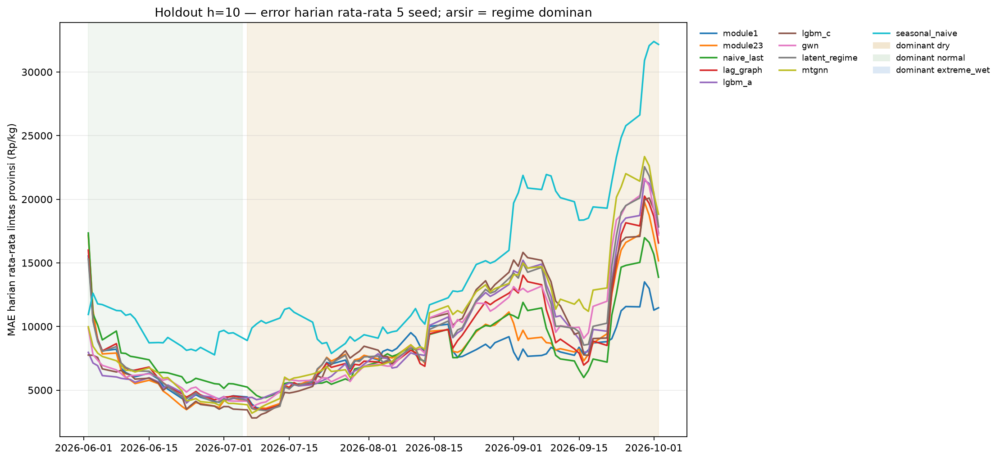
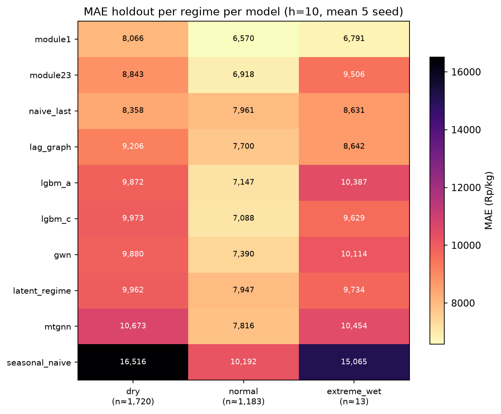
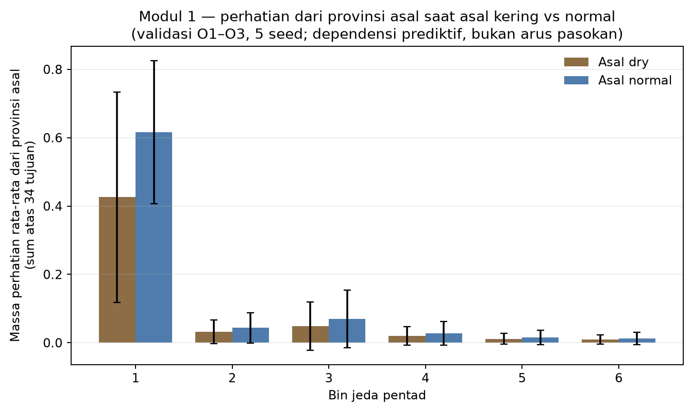
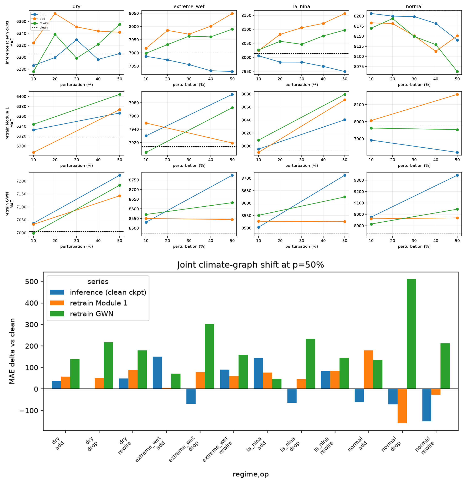

# 6. Eksperimen dan Hasil

> **Status Dokumen**: Draf Sprint 1 (`ALL-H6-01`) · **Peran**: MLE (*ML/Graph Modeling Engineer*, `@agus`; eksekusi laporan oleh `@fariq`) · **Tanggal**: Sabtu, 28 November 2026 (`H6`)
> **Rujukan**: `docs/decisions/GATE2.md`, `frozen/manifest.yaml`, `reports/h5/gate2_validation_summary.csv`, `reports/holdout/table_main.md`, `reports/holdout/findings.md`, `reports/ablation/ablation_summary.md`, `reports/synth/recovery_summary.md`, `reports/robustness/robustness_summary.md`.

---

## 6.1 Setup eksperimen

- **Dataset**: `data/processed/dataset_v1` (tag `dataset-v1`; panel 76.228 baris = 2.242 hari kerja × 34 provinsi; target teramati 98,3%; `split_hash = 411aec1a...`).
- **Frekuensi & horizon**: hari kerja PIHPS; jendela input 60 hari kerja; horizon $h \in \{5,10,20\}$ dengan **$h=10$ sebagai horizon utama**.
- **Split**: rolling-origin O1 (uji 2023), O2 (uji 2024), O3 (uji 2025–Mei 2026) dengan embargo 20 hari kerja; **holdout** 2026-06-01..2026-10-31, dibuka satu kali oleh CGS-H6-01.
- **Seed**: 5 seed (`0..4`) untuk setiap model.
- **Model**: 8 model wajib + 2 pendamping, semuanya dibekukan di Gate 2 (`frozen/manifest.yaml`, 10 model × 5 seed = 50 checkpoint):

| Model | Keluarga | Peran |
|---|---|---|
| `seasonal_naive` | naive | Baseline wajib #1 (musiman) |
| `naive_last` | naive | Pendamping (martingale) |
| `lgbm_a` | LightGBM | Pendamping (harga + kalender) |
| `lgbm_c` | LightGBM | Baseline wajib #2 (harga + iklim + kalender); **best baseline on validation** |
| `gwn` | Graph WaveNet-lite | Baseline wajib #3 |
| `mtgnn` | MTGNN-lite | Baseline wajib #4 |
| `latent_regime` | graph (ala RCSGNet) | Baseline wajib #5 |
| `lag_graph` | graph (ala MillGNN) | Baseline wajib #6 |
| `module1` | climate-conditioned directed lag graph | Metode inti |
| `module23` | Modul 1–3 + reliability gate | Metode inti |

- **Konfigurasi beku**: `configs/models/gate2/*.yaml`; 6 model neural memakai `epochs=10`, `patience=10` (Amandemen A4). Checkpoint HOLDOUT di-*refit* pada latih ≤ 2025-12-31 dan val 2026-01-01..2026-05-31.
- **Metrik**: MAE (Rp/kg) utama; RMSE (Rp/kg), sMAPE (%), `worst-regime MAE`, `Δ dry−normal`, stabilitas 5 seed (sd), dan Diebold–Mariano (HAC + HLN). MAE hanya pada `y_mask=True` dan `y_pred` finite; tanpa imputasi target.
- **Anti-kebocoran**: fitur `available_at <= t`; tidak ada label regime di panel/fitur; `tests/test_no_leakage.py` 15/15 lulus; 200/200 run `g2_*` berakhir < 2026-06-01.

---

## 6.2 Validasi O1–O3 (pra-holdout)

Sumber angka: `reports/h5/gate2_validation_summary.csv` (h=10, rata-rata 3 origin).

| Model | Val O1 | Val O2 | Val O3 | **Val 3-origin** | Max CV | Test 3-origin | Val refit HOLDOUT |
|---|---:|---:|---:|---:|---:|---:|---:|
| `seasonal_naive` | 24.422,56 | 23.880,92 | 17.796,22 | 22.033,23 | 0,00% | 17.389,27 | 15.289,29 |
| `naive_last` | 7.988,33 | 6.541,76 | 3.977,90 | 6.169,33 | 0,00% | 6.782,78 | 7.050,58 |
| `lgbm_a` | 6.279,71 | 6.543,17 | 3.806,59 | 5.543,16 | 0,63% | 6.667,56 | 5.861,57 |
| **`lgbm_c`** | 6.091,26 | 6.553,97 | 3.798,37 | **5.481,20** | 1,12% | 6.914,47 | 6.042,09 |
| `gwn` | 7.393,35 | 8.095,18 | 4.108,22 | 6.532,25 | 13,33% | 7.622,41 | 5.965,67 |
| `mtgnn` | 7.211,26 | 7.837,36 | 4.250,86 | 6.433,16 | 7,68% | 7.419,48 | 5.878,79 |
| `latent_regime` | 6.825,06 | 7.121,88 | 3.896,37 | 5.947,77 | 2,37% | 7.029,15 | 6.353,22 |
| `lag_graph` | 6.869,25 | 7.235,84 | 3.879,87 | 5.994,99 | 4,01% | 7.100,21 | 6.240,28 |
| `module1` | 7.085,61 | 7.774,84 | 3.886,58 | 6.249,01 | 9,79% | 7.396,89 | 6.431,12 |
| `module23` | 7.013,81 | 7.767,62 | 3.883,02 | 6.221,48 | 5,25% | 7.285,14 | 6.370,09 |

**Temuan validasi.** `lgbm_c` adalah baseline terbaik (`Rp5.481,20/kg`), diikuti `lgbm_a` (`Rp5.543,16`) dan `latent_regime` (`Rp5.947,77`). `module1` dan `module23` belum mengalahkan `lgbm_c` pada rata-rata validasi, tetapi `module23` mengungguli `module1`, `gwn`, dan `mtgnn`. `gwn` (CV 13,33%) dan `module1` (CV 9,79%) menunjukkan sensitivitas seed sedang. `lgbm_c` ditetapkan sebagai `best_baseline_on_validation` **sebelum** holdout dibuka; penetapan ini tidak diubah setelah holdout.

---

## 6.3 Hasil holdout (CGS-H6-01)

Holdout dibuka satu kali pada `2026-11-28T21:13:19+07:00`; 50 prediksi beku dijalankan tanpa pelatihan ulang (`reports/holdout/QA_predictions.md`). Ringkasan h=10:

| Model | Val 3-origin | **Holdout MAE** | Δ vs val | Worst-regime | Δ dry−normal | DM median p | Sig. p<0.05 |
|---|---:|---:|---:|---:|---:|---:|---:|
| **`module1`** | 6.249,0 | **7.452,6 ± 211,4** | +1.203,6 | 8.065,5 | +1.495,8 | 0,0744 | 0/5 |
| `module23` | 6.221,5 | 8.064,7 ± 467,2 | +1.843,2 | 9.505,9 | +1.924,5 | 0,1595 | 0/5 |
| `naive_last` | 6.169,3 | 8.198,4 ± 0,0 | +2.029,0 | 8.630,8 | +397,2 | 0,2215 | 0/5 |
| `lag_graph` | 5.995,0 | 8.592,5 ± 332,2 | +2.597,5 | 9.206,5 | +1.506,1 | 0,3737 | 0/5 |
| `lgbm_a` | 5.543,2 | 8.767,9 ± 39,0 | +3.224,8 | 10.387,3 | +2.724,1 | 0,4426 | 0/5 |
| **`lgbm_c`** | **5.481,2** | 8.800,5 ± 71,9 | +3.319,3 | 9.973,4 | +2.885,2 | — | — |
| `gwn` | 6.532,2 | 8.870,0 ± 978,6 | +2.337,8 | 10.114,1 | +2.489,9 | 0,2272 | 0/5 |
| `latent_regime` | 5.947,8 | 9.142,8 ± 406,5 | +3.195,1 | 9.962,0 | +2.015,3 | 0,7523 | 0/5 |
| `mtgnn` | 6.433,2 | 9.512,2 ± 1.417,7 | +3.079,0 | 10.673,0 | +2.857,0 | 0,7092 | 0/5 |
| `seasonal_naive` | 22.033,2 | 13.957,2 ± 0,0 | −8.076,1 | 16.516,4 | +6.324,0 | 1,0000 | 0/5 |



*Gambar 6.1 — MAE harian rata-rata lintas provinsi (h=10, mean 5 seed); arsir = regime dominan. `seasonal_naive` tetap terburuk; `module1` umumnya paling rendah pada periode kering.*



*Gambar 6.2 — MAE holdout per regime per model (h=10, mean 5 seed). `extreme_wet` hanya 13 observasi per horizon; sel ini tidak stabil.*

**Interpretasi.**
1. **Titik estimasi**: `module1` terbaik (7.452,6), 15,3% di bawah `lgbm_c` (8.800,5) dan 7,6% di bawah `module23` (8.064,7).
2. **Signifikansi**: DM satu sisi vs `lgbm_c` menghasilkan median p = 0,074 untuk `module1`; **0/5 seed** < 0,05. Tidak ada klaim superiority statistik. `module1` hanya menunjukkan arah positif.
3. **Peringkat berubah**: `lgbm_c` yang terbaik di validasi menjadi lebih buruk dari `module1`, `module23`, `naive_last`, dan `lag_graph` di holdout. Degradasi `lgbm_c` (+3.319) jauh lebih besar dari `module1` (+1.204).
4. **Worst-regime**: `module1` worst-regime 8.065 vs `lgbm_c` 9.973. `module23` worst-regime 9.506 karena `extreme_wet` (n=13); jika dibatasi n≥200, worst-regime `module23` 8.843.
5. **Stabilitas**: sd seed `module1` 211 (CV ~2,8%), `lgbm_c` 72 (~0,8%), `module23` 467, `gwn` 979, `mtgnn` 1.418. `module1` lebih baik rata-rata tetapi kurang stabil dari `lgbm_c`.
6. **ENSO**: tidak ada label `el_nino`/`la_nina` karena RONI resmi netral; rencana "holdout El Niño vs normal" tidak dapat dijalankan. Yang dihitung adalah `dry` vs `normal` dan `extreme_wet` vs `normal`.
7. **Kualitas**: `seasonal_naive` 75 NaN/file (0,86%; lag 364 hari tidak tersedia); coverage 99,21%. Model lain 0 NaN. Semua angka dapat dilacak ke `reports/holdout/metrics_by_seed.csv`, `metrics_by_regime.csv`, dan `dm_tests.csv`.

Detail lengkap: `reports/holdout/table_main.md` dan `reports/holdout/findings.md`.

### 6.3.1 Attention Modul 1: asal kering vs normal (validasi)

`A_by_regime.npz` H4-01 mengondisikan attention pada regime **tujuan**. Untuk pertanyaan "saat asal kering vs normal", attention dihitung ulang dari 15 checkpoint Module 1 (O1–O3 × 5 seed) pada validasi; massa perhatian dari asal $j$ adalah $\sum_i A_{i,j,\ell}$. Hasil (mean 15 run untuk `dry`, 10 run untuk `normal`):

| Lag | Asal `dry` | Asal `normal` |
|---:|---:|---:|
| 1 | 0,426 | 0,616 |
| 2 | 0,032 | 0,044 |
| 3 | 0,049 | 0,070 |
| 4 | 0,020 | 0,028 |
| 5 | 0,012 | 0,016 |
| 6 | 0,009 | 0,012 |

Provinsi asal yang kering menerima **massa perhatian lebih rendah** daripada asal normal pada semua lag, terutama lag 1 (0,426 vs 0,616). Ini adalah **dependensi prediktif, bukan arus pasokan**. Angka: `reports/holdout/attention_origin_dry_normal.csv`; figur: `fig_A_dry_vs_normal.png`.



*Gambar 6.3 — Massa perhatian Modul 1 dari provinsi asal saat asal kering vs normal (validasi O1–O3; 15 run dry, 10 run normal karena O1 val tidak punya hari normal).*

---

## 6.4 Ablation (MLE-H5-02)

Eksperimen ablation memakai `module23` dengan anggaran **1 epoch** yang sama untuk semua varian (bukan pengganti H5-01 2 epoch); angka lengkap di `reports/ablation/ablation_summary.md`.

| Varian | MAE h=10 | Δ vs full | Δ % |
|---|---:|---:|---:|
| `full` | 8.168,40 ± 2.683,90 | +0,00 | +0,00% |
| `no_climate` | 8.265,19 ± 3.373,56 | +96,78 | +1,18% |
| `no_lag` | 8.561,19 ± 3.112,47 | +392,79 | +4,81% |
| `no_gate` | 8.716,22 ± 3.510,60 | +547,81 | +6,71% |
| `no_calendar` | 7.731,32 ± 2.600,13 | **−437,08** | **−5,35%** |

**Temuan.** Komponen lag (+4,81%) dan gate (+6,71%) paling berkontribusi pada MAE h=10; iklim lokal + asal hanya +1,18% pada budget 1 epoch. **Hasil negatif**: menghapus kalender justru menurunkan MAE 5,35% pada setup ini; efek kalender tidak robust dan tidak boleh diklaim sebagai kontribusi positif tanpa uji tambahan. Perbedaan `full` (8.168) vs H5-01 2 epoch (6.864,81) konsisten dengan pengurangan epoch, bukan kontradiksi.

---

## 6.5 Uji pemulihan jeda sintetis (MLE-H3-01)

Sumber: `reports/synth/recovery_summary.md`; ambang protokol: Spearman > 0,70, MAE lag ≤ 1,0 pentad, AUROC > 0,85.

| Data | Model | Regime | Spearman | MAE lag | AUROC | Δ lag |
|---|---|---|---:|---:|---:|---:|
| default | Module 1 | dry | 0,636 | 0,644 | 1,000 | 0,813 |
| default | Module 1 | normal | 0,854 | 0,408 | 1,000 | 0,813 |
| default | no-climate | dry | 0,759 | 0,628 | 1,000 | 0,011 |
| default | no-climate | normal | 0,752 | 2,313 | 1,000 | 0,011 |
| unconditioned | Module 1 | dry | 0,734 | 0,493 | 1,000 | −0,041 |
| unconditioned | Module 1 | normal | 0,730 | 0,505 | 1,000 | −0,041 |

**Temuan.** Module 1 default lulus ambang gabungan: MAE lag 0,526, AUROC 1,000, dan Δ lag 0,813 (nilai benar sintetis 2,0). **Hasil negatif**: Spearman dry-only 0,636 berada **di bawah** ambang 0,70; hanya rata-rata normal+dry (0,745) yang lulus. Kontrol no-climate/unconditioned memiliki |Δ lag| 0,026 (mendekati 0), sesuai desain. Jangan mengklaim pemulihan jeda yang kuat pada rezim kering dari uji ini.

---

## 6.6 Robustness prior graf (CGS-H5-01)

Sumber: `reports/robustness/robustness_summary.md`; evaluasi validasi/test O3, bukan holdout.

- **Inferensi tanpa retrain**: MAE clean test h10 Module 1 7.819,27 ± 207,38; p=50 7.852,12 (Δ +32,85).
- **Retrain subset**: Module 1 rewire p50 Δ +83,01 (+1,06%), drop p50 +23,28 (+0,30%); GWN drop p50 +196,17 (+2,29%), rewire p50 +106,26 (+1,24%). Module 1 lebih tahan.
- **Joint shift p50**: GWN normal drop +440,33 (+5,22%) adalah degradasi terbesar; Module 1 normal add +165,09 (+2,19%), dry add +40,61 (+0,64%).
- **Batas**: 42 run retrain subset (7 prior × 3 model seed × 2 model) memakai seed 0–2, bukan 5 seed; ini keterbatasan yang tercatat.



*Gambar 6.4 — Gabungan kurva robustness CGS-H5-01: MAE vs perturbasi per regime (atas) dan joint shift p=50 (bawah).*

---

## 6.7 Ringkasan per RQ

- **RQ0 (H3)**: sinyal iklim asal lulus Gate 1 pada `el_nino` dan `dry`, tetapi tidak universal (`la_nina` melemah). Bukan hasil holdout.
- **RQ1 (holdout)**: `module1` terbaik secara titik estimasi (MAE 7.452,6 vs `lgbm_c` 8.800,5), tetapi DM tidak signifikan (median p 0,074; 0/5 seed < 0,05). Dukungan arah, bukan superiority statistik.
- **RQ2**: worst-regime dan degradasi `dry` Module 1 lebih rendah dari `lgbm_c`; `extreme_wet` hanya 13 observasi; tidak ada holdout El Niño resmi. Stabilitas seed Module 1 lebih rendah dari `lgbm_c` (sd 211 vs 72).
- **RQ3**: robustness Module 1 lebih baik dari GWN pada perturbasi prior dan joint shift di validasi; holdout tidak menguji perturbasi graf. Tidak ada klaim invariansi penuh.

**Hasil negatif yang wajib dilaporkan:** peringkat validasi tidak bertahan di holdout (`lgbm_c` turun); tidak ada model yang signifikan mengalahkan `lgbm_c`; `no_calendar` lebih baik dari `full` pada ablation; Module 1 dry-only synthetic Spearman 0,636 < 0,70; `seasonal_naive` 75 NaN/file; `mtgnn` sangat tidak stabil; tidak ada `el_nino`/`la_nina` di holdout.

---

## 6.8 Reproduksi

```powershell
$env:PYTHONPATH="$PWD\src"
python scripts\analyze_holdout.py                  # tabel, DM, figur holdout
python scripts\attention_origin_regime.py          # fig_A_dry_vs_normal
python scripts\aggregate_ablation.py               # ringkasan ablation
python -m pytest -q tests\test_no_leakage.py       # 15 passed
python scripts\cgs\verify_holdout_integrity.py --require-checkpoints  # 50/50
```

Artefak kunci: `reports/holdout/{table_main.md, findings.md, metrics_*.csv, dm_*.csv, fig_*.png}`, `reports/ablation/`, `reports/synth/`, `reports/robustness/`, `experiments/registry.csv`, `frozen/manifest.yaml`.

---

## 6.9 Batas klaim

1. Holdout didominasi `dry` (57,6%), `normal` 41,8%, `extreme_wet` 0,6%; tidak ada `el_nino`/`la_nina` resmi. Klaim per regime hanya untuk `dry`/`normal`; `extreme_wet` terlalu kecil (n=13).
2. DM tidak signifikan; hasil holdout adalah bukti arah, bukan konfirmasi statistik.
3. Peringkat validasi ≠ holdout; baseline tetap `lgbm_c` sesuai manifest, bukan dipilih ulang.
4. `seasonal_naive` NaN 75/file; metrik mengecualikan baris tersebut (coverage 99,21%).
5. Ablation memakai 1 epoch (matched budget), bukan 2 epoch H5-01; angka `full` ablation bukan pengganti H5-01.
6. Uji sintetis adalah kontrol mekanisme, bukan bukti performa data riil.
7. Label regime EVAL ONLY; tidak ada klaim kausal atau arus pasokan. Attention adalah dependensi prediktif.
8. Semua hasil holdout adalah hasil pertama; tidak ada run ulang. Perubahan setelah titik ini adalah post-hoc.
